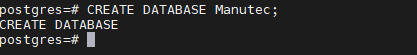
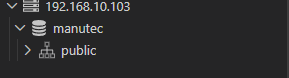
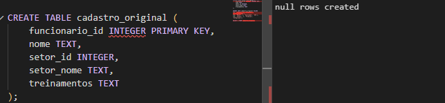
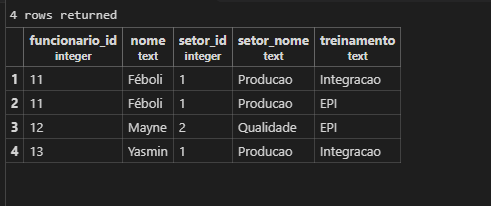
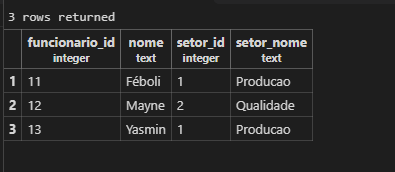
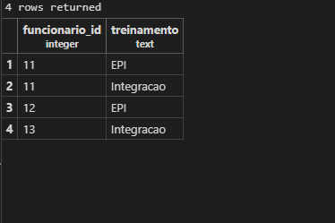
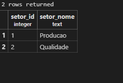
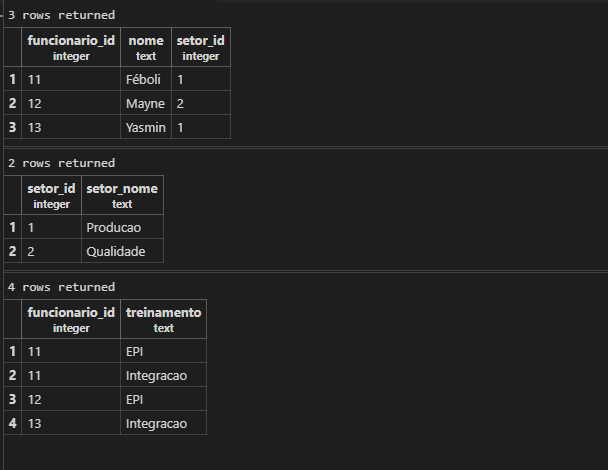

### Atividade de Normalização de Banco de Dados 

1- Criação da loja no postgres 


2- Conectar com o VS Code:


3- Criar a tabela:


4- Agora eu inseri as insformações na tabela: 
```sql

INSERT INTO cadastro_original VALUES
(11, 'Féboli', 1, 'Producao', 'Integracao;EPI'),
(12, 'Mayne', 2, 'Qualidade', 'EPI'),
(13, 'Yasmin', 1, 'Producao', 'Integracao');
```
> Sendo que ele retorna 3 linhas afinal são 3 pessoas


4- Para verificar a tabela: 
```sql
SELECT * FROM cadastro_original;
```
5- Para criar o cadastro_1fn a partir da tabela original, separando o campo treinamentos no ponto e vírgula.Definindo a chave composta por funcionario_id e treinamento. Eu usei:

```sql
CREATE TABLE cadastro_1fn AS 
SELECT funcionario_id,nome,setor_id,setor_nome,
    string_to_table(treinamentos, ';') AS 
    treinamento 
FROM cadastro_original;
```
6- Atribuimos a tabela :
Primeira forma normal 
```sql
ALTER TABLE cadastro_1fn
ADD PRIMARY KEY (funcionario_id, treinamento);
```
7- Para conferir o resultado:
```sql
SELECT * FROM cadastro_1fn;
```


## Segunda Parte criar uma tabela separada para funcionarios e participações

1- Para criar a tabela:
```sql
CREATE TABLE funcionarios AS
SELECT DISTINCT
    funcionario_id,
    nome,
    setor_id,
    setor_nome
FROM cadastro_1fn;
```
2- Como o comando CREATE TABLE AS não traz as chaves primárias automaticamente, dessa forma, executamos o comando : 
```sql
ALTER TABLE funcionarios
ADD PRIMARY KEY (funcionario_id);
```
3-
```sql
 SELECT * FROM funcionarios
ORDER BY funcionario_id;
```


>Resultado: 3 funcionários, cada um cadastrado uma única vez.

4- criar a tabela Participações:
```sql
CREATE TABLE participacoes AS
SELECT
    funcionario_id,
    treinamento
FROM cadastro_1fn;
```


5- Usando a chave primária
```sql 
ALTER TABLE participacoes
ADD PRIMARY KEY (funcionario_id, treinamento);
```
6- A chave estrangeira garante que uma participação esteja associada a um funcionário cadastrado.
```sql
ALTER TABLE participacoes
ADD CONSTRAINT fk_participacoes_funcionarios
FOREIGN KEY (funcionario_id)
REFERENCES funcionarios (funcionario_id);
```
7- Para verificar :
```sql
SELECT * FROM participacoes
ORDER BY funcionario_id, treinamento;
```


### Criar tabela 3FN Terceira Forma normal 

1- Criar tabela se setores 
```sql
CREATE TABLE setores AS
SELECT DISTINCT
    setor_id,
    setor_nome
FROM funcionarios;
```


2- Usando as chaves
```sql
ALTER TABLE setores
ADD PRIMARY KEY (setor_id);
```
3- Para ver a tabela :
```sql
SELECT * FROM setores
ORDER BY setor_id;
```


### Relacionar funcionarios com setores
>Adicionando a chave estrangeira e o preenchimento de setor_id. Depois, removi somente a coluna setor_nome de funcionarios, como a atividade pede.

1- Criando a tabela e a regra de relacionamento entre as tabelas
```sql
ALTER TABLE funcionarios
ADD CONSTRAINT fk_funcionarios_setores
FOREIGN KEY (setor_id)
REFERENCES setores (setor_id);
```
2- Colocando as chaves:
```
ALTER TABLE funcionarios
ALTER COLUMN setor_id SET NOT NULL;
```
3- Retira somente o nome do setor da tabela funcionarios 
```sql
ALTER TABLE funcionarios
DROP COLUMN setor_nome;
```

> Por ultímo vamos conferir as tabelas 
```sql
SELECT * FROM funcionarios
ORDER BY funcionario_id;

SELECT * FROM setores
ORDER BY setor_id;

SELECT * FROM participacoes
ORDER BY funcionario_id, treinamento;
```
