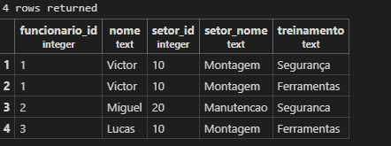
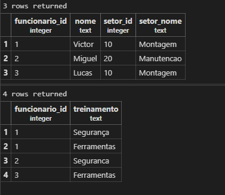
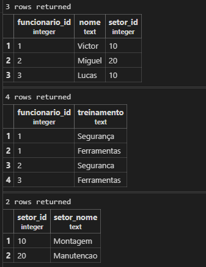
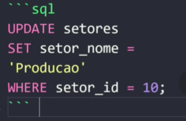

## Normalização de Banco de Dados
Objetivo normalizar um banco de dados: 

```sql
CREATE DATABASE empresa;
```
2.Criamos a tabela original
```sql
CREATE TABLE cadastro_original (
    funcionario_id INTEGER PRIMARY KEY,
    nome TEXT,
    setor_id INTEGER,
    setor_nome TEXT,
    treinamentos TEXT
);
```
3- Inserimos os dados na tabela

```sql
INSERT INTO cadastro_original VALUES
(1, 'Victor', 10, 'Montagem', 'Segurança;Ferramentas'),
(2, 'Miguel', 20, 'Manutencao', 'Seguranca'),
(3, 'Lucas', 10, 'Montagem', 'Ferramentas');
```

4- Ao realizar a primeira consulta, verificamos que o Victor está com dois registros na mesma linha 


```sql
SELECT * FROM cadastro_original
```
### 1FN
5- Criamos uma nova tabela com a 1fn:
```sql
CREATE TABLE cadastro_1fn AS 
SELECT funcionario_id,nome,setor_id,setor_nome,
    string_to_table(treinamentos, ';') AS 
    treinamento 
FROM cadastro_original;
```


6- Atribuimos a tabela :
Primeira forma normal 
```sql
ALTER TABLE cadastro_1fn
ADD PRIMARY KEY (funcionario_id, treinamento);
```
7- Tabela depois da verificação 

> Para conferir a modificação:
```sql
SELECT * FROM cadastro_1fn;
```


### 2FN
Por enquanto nós temos uma tabela para tudo, por isso será que não seria mais facíl uma tabela só para treinamentos, uma só pra férias uma só pra faltas ? É o que vamos fazer uma tabela de funcionários e uma de participação.

1- Priemiro criamos a tabela de funcionários:
> Ele retorna 3 linhas por que são 3 funcionários

```sql
CREATE TABLE funcionarios AS
SELECT DISTINCT funcionario_id,nome,setor_id,setor_nome
FROM cadastro_1fn;
```
> O `DISTINCT` evita copiar linhas iguais mais de uma vez. Ou seja: Os dois treinamentos do Victor viram apenas um só.

2- O comando CREATE TABLE AS não traz as chaves primárias automaticamente, dessa forma, executamos o comando :
```sql
ALTER TABLE funcionarios 
ADD PRIMARY KEY 
(funcionario_id);
```
3-Criamos a tabela PARTICIPAÇÕES, trazendo apenas o ID do funcionário e os seus treinamentos.

```sql
CREATE TABLE participacoes AS SELECT
funcionario_id,
treinamento FROM cadastro_1fn;
```

4- Adicionamos as chaves primárias:

```sql
ALTER TABLE participacoes
ADD PRIMARY KEY (funcionario_id,treinamento);
```

5- Adicionamos as chaves estrangeiras:
```sql
ALTER TABLE participacoes
ADD FOREIGN KEY 
(funcionario_id)
REFERENCES funcionarios
(funcionario_id);
```
6- Verificando a 2FN: 
   Para testar :
```
SELECT * FROM funcionarios; 
SELECT * FROM participacoes;
````


##3 3FN 

1- Criamos a tabela setores:
```sql
CREATE TABLE setores AS SELECT DISTINCT setor_id,
setor_nome
FROM funcionarios;
```

2- Adicionando a chave primária
```sql
ALTER TABLE setores
ADD PRIMARY KEY 
(setor_id);
```

3- Criamos a chave estrangeira:
```sql
ALTER TABLE funcionarios
ADD FOREIGN KEY 
(setor_id) REFERENCES
setores(setor_id);
```
4- Correção do erro na hora de criar a tabela:
> o COMANDO `ALTER COLUMN`é muito importante pois modifica a coluna sem apagar a tabela. Por exemplo o cara fazendo o site do banco esqueceu de colocar a verificação do CPF    .
```sql
ALTER TABLE funcionarios
ALTER COLUMN setor_id
SET NOT NULL;
```
5- Apagamos a coluna setor-nome 
```sql
ALTER TABLE funcionarios
DROP COLUMN setor_nome;
```
6- Consultando os resultados:
```sql
SELECT * FROM funcionarios;
SELECT * FROM participacoes;
SELECT * FROM setores;
```


7-Ultima etapa.
 Dessa maneira fica muito mais fácil de modificar as colunas separadas depois:
 
 