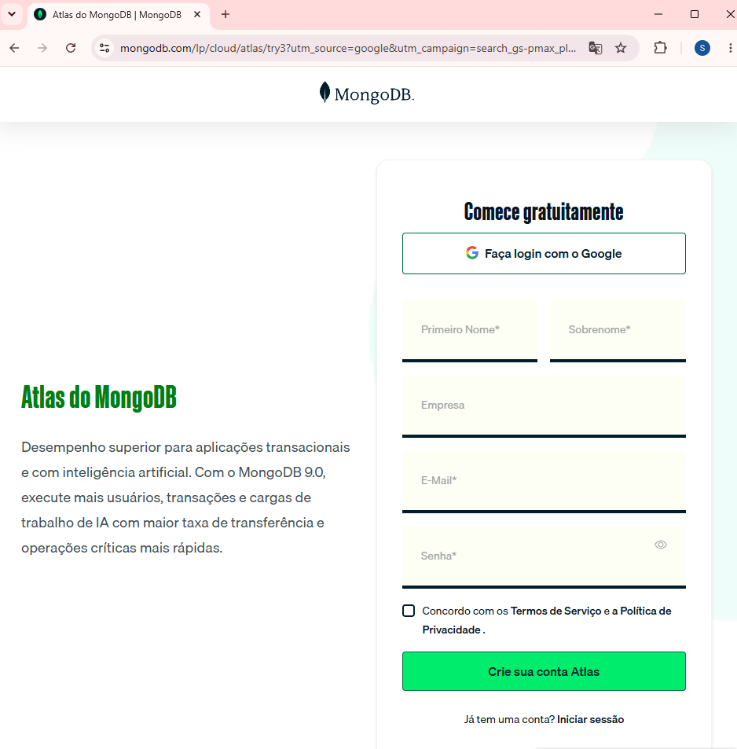
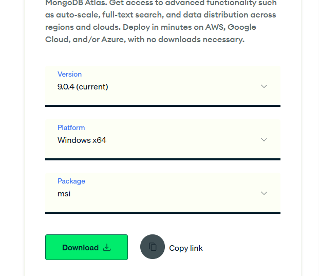

## Como isntalar e usar o MongoDob ###

O mongoDob é um importante banco de dados NoSQL orientado a documentos que oferece alta flexibilidade, desempenho e facilidade de escala para aplicações modernas. 

Para abaixar acesso o sie: `https://www.mongodb.com/lp/cloud/atlas/try3?utm_source=google&utm_campaign=search_gs-pmax_pl_evergreen_atlas_general_prosp_gic-null_amers-br_ps-all_dv-all_eng_lead&utm_term=&utm_medium=paid_pmax&utm_ad=&utm_ad_campaign_id=23331372649&adgroup=&cq_cmp=23331372649&gad_source=1&gad_campaignid=23322235101&gbraid=0AAAAADQ1400GlMhttdd2RXyoCuppfHmt2&gclid=CjwKCAjwuobXBhBXEiwAYUaIleDdlts4jlLaEr1Hq6SfCyc6wIvK1brO1W1_hstwXZdT82Idq74ZhBoCE8UQAvD_BwE` caso ele pergunte pode aceitar os`cooekis``.

### Tecnologias utilizadas:

Node.js: ambiente utilizado para executar o JavaScript no servidor.

Express: biblioteca utilizada para criar as rotas da API.

MongoDB Atlas: banco de dados não relacional utilizado para armazenar os produtos na nuvem.

Thunder Client: extensão do VS Code utilizada para testar as requisições HTTP.

Visual Studio Code: editor utilizado para desenvolver o projeto

Depois de entrar na tela principal caso n seja cadastrado coloque as suas insformações para criar uma conta 
> Lembrese de anotar a senha o ususario, e o link que aparece logó após realizar a conta.

### Para instalar o MongoDob no computador
É muito facíl basta entrar pelo link `https://www.mongodb.com/try/download/community-kubernetes-operator` e abaixar no seu computador clicando no buton verde de Dowload, como mostra a imagem abaixo 

> lembrese de verificar semper a versão mais recente do seu computdaor.

Depois que vc abaixar ele vai aparecer provavelmente em seus dowloads 

Ao abrir ele vai pedir várias autorizações pode ficar tranquila e apertar next. Ao final ele vai realizar um carregamente de 100% e abrir nesta pagína inicial.

### Criar uma conta
Você pode realizar o cadastro utilizando seu e-mail ou uma conta Google.
Depois de entrar, você será direcionado ao painel principal do MongoDB Atlas.

### Criar um projeto
Acesse a área de projetos.
Clique em New Project.
Escolha um nome para o projeto.
Clique em Create Project.

### Criando um banco de dados
Agora vamos criar o ambiente onde os produtos serão armazenados.
Criar um cluster
Dentro do projeto, clique em Build a Database.
Escolha a opção gratuita, quando disponível (Free).
Selecione um provedor de nuvem e uma região disponível.
Dê um nome ao cluster.
Clique em Create.

> importante: 
 cluster será responsável por hospedar o banco de dados.

### Acessar o banco
Depois de criar o cluster:
Entre em Database.
Clique em Browse Collections.

Se ainda não existir um banco, ele poderá ser criado quando a aplicação inserir o primeiro documento.

### Para começar com os codígos 
Depois de tudo instalado vamos ao vs code. Aonde criamos umas pasta chamada api-mongo-db. criamos a pasta `.gitgnore`
API REST simples desenvolvida para cadastrar, listar, atualizar e deletar produtos no banco de dados MongoDB.
Tecnologias e Configuracoes
Node.js + Express: Criacao do servidor e rotas HTTP.
MongoDB: Banco de dados para armazenar os produtos.
Thunder Client: Ferramenta no VS Code para testar as requisicoes.
.env: Guarda a senha e endereco de conexao do banco em segredo.
.gitignore: Impede que o .env e pastas do projeto subam para o Git.

> Como Executar
npm install
node index.js

### Entendendo como a API funciona
A API utiliza cinco operações principais para administrar os produtos.

O funcionamento acontece da seguinte maneira:

flowchart LR
    A["Thunder Client"] --> B["API Node.js + Express"]
    B --> C["MongoDB Atlas"]
    C --> D["Banco de dados"]
    D --> C
    C --> B
    B --> A

O Thunder Client envia uma requisição para a API. A API interpreta essa solicitação, realiza a operação no MongoDB e devolve uma resposta.

### Como editar e excluir diretamente pelo MongoDB Atlas

Além de utilizar a API, também podemos administrar os documentos diretamente pelo painel do MongoDB Atlas.
Como editar um produto
Entre no MongoDB Atlas.
Acesse Database.
Clique em Browse Collections.
Escolha o banco api_produtos.
Abra a coleção produtos.
Localize o documento que deseja modificar.
lique na opção Edit.
Altere os campos desejados.
Clique em Update ou Save.

> Dessa maneira, as informações serão atualizadas diretamente no banco de dados.

### Como excluir um produto
Acesse Browse Collections.
Abra o banco api_produtos.
Entre na coleção produtos.
Localize o documento desejado.
Clique na opção Delete.
Confirme a exclusão.

> Atenção: a exclusão é permanente. Confira o documento antes de confirmar.

### Como excluir uma coleção inteira

Entre em Browse Collections.
Localize a coleção produtos.
Abra o menu de opções.
Escolha Drop Collection.
Confirme a operação.

Isso excluirá todos os documentos daquela coleção e sua própria estrutura.

Não confunda excluir um documento com excluir uma coleção inteira!