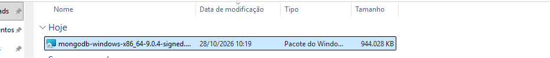
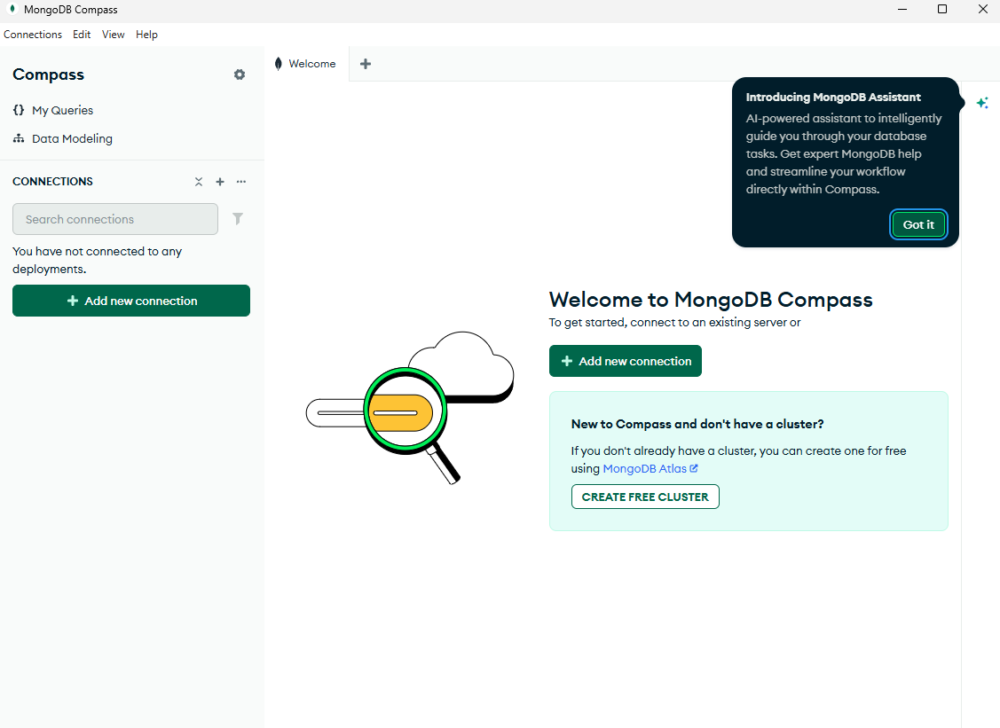

## Como isntalar e usar o MongoDob ###

O mongoDob é um importante banco de dados NoSQL orientado a documentos que oferece alta flexibilidade, desempenho e facilidade de escala para aplicações modernas. 

Para abaixar acesso o sie: `https://www.mongodb.com/lp/cloud/atlas/try3?utm_source=google&utm_campaign=search_gs-pmax_pl_evergreen_atlas_general_prosp_gic-null_amers-br_ps-all_dv-all_eng_lead&utm_term=&utm_medium=paid_pmax&utm_ad=&utm_ad_campaign_id=23331372649&adgroup=&cq_cmp=23331372649&gad_source=1&gad_campaignid=23322235101&gbraid=0AAAAADQ1400GlMhttdd2RXyoCuppfHmt2&gclid=CjwKCAjwuobXBhBXEiwAYUaIleDdlts4jlLaEr1Hq6SfCyc6wIvK1brO1W1_hstwXZdT82Idq74ZhBoCE8UQAvD_BwE` caso ele pergunte pode aceitar os`cooekis``.

Depois de entrar na tela principal caso n seja cadastrado coloque as suas insformações para criar uma conta 
> Lembrese de anotar a senha o ususario, e o link que aparece logó após realizar a conta.

### Para instalar o MongoDob no computador
É muito facíl basta entrar pelo link `https://www.mongodb.com/try/download/community-kubernetes-operator` e abaixar no seu computador clicando no buton verde de Dowload, como mostra a imagem abaixo 

> lembrese de verificar semper a versão mais recente do seu computdaor.

Depois que vc abaixar ele vai aparecer provavelmente em seus dowloads 

Ao abrir ele vai pedir várias autorizações pode ficar tranquila e apertar next. Ao final ele vai realizar um carregamente de 100% e abrir nesta pagína inicial.

### Para começar com os codígos 
Depois de tudo instalado vamos ao vs code. Aonde criamos umas pasta chamada api-mongo-db. criamos a pasta `.gitgnore`

API REST simples desenvolvida para cadastrar, listar, atualizar e deletar produtos no banco de dados MongoDB.

Tecnologias e Configuracoes

Node.js + Express: Criacao do servidor e rotas HTTP.

MongoDB: Banco de dados para armazenar os produtos.

Thunder Client: Ferramenta no VS Code para testar as requisicoes.

.env: Guarda a senha e endereco de conexao do banco em segredo.

.gitignore: Impede que o .env e pastas do projeto subam para o Git.

Como Executar

npm install
node index.js